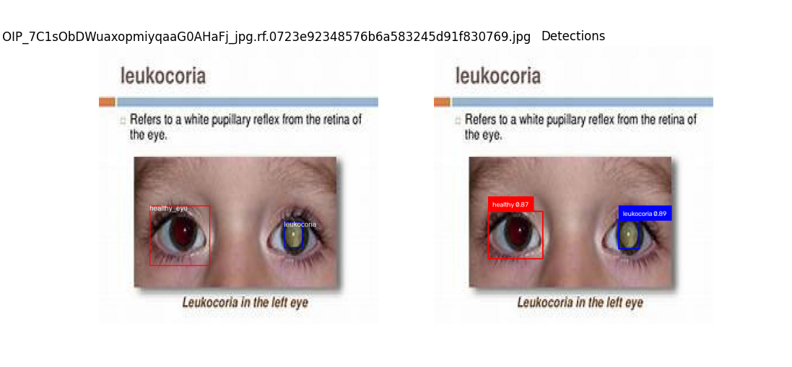

# Detect_Leukocoria_RFDETRBase

Development and testing of a model to detect the clinical ophthalmological sign known as "leukocoria," trained using RFDETRnano on a dataset from Roboflow: https://universe.roboflow.com/leukocoria-detector-nv8ij/leukocoria-detector-rsl8x/dataset/2 on a laptop with 16Gb of RAM

INTRODUCTION
====================================================================

According to Google:

Leukocoria (commonly known as "white pupil" or "amaurotic cat's eye") is a clinical sign characterized by the appearance of a white reflection or spot in the pupil, rather than the normal reddish or orange reflection that occurs when light hits the back of the eye.

What causes it?

This sign appears when there is an opacity or an alteration in the internal structures of the eye (from the cornea to the retina) that prevents light from reflecting in the usual way:

• Retinoblastoma: A malignant intraocular tumor that is very common in childhood; it accounts for nearly 50% of leukocoria cases in children.

• Congenital cataracts: An opacity of the lens present from birth.

• Persistent fetal vasculature (or primary hyperplastic vitreous): A failure in the regression of the eye's fetal blood vessels.

• Coats' disease: An abnormality in the retinal blood vessels that leads to exudation and retinal detachment.

• Retinopathy of prematurity (ROP): An alteration in the growth of retinal blood vessels in premature infants.

• Other causes: Ocular toxoplasmosis, toxocariasis, retinal detachment, or optic nerve abnormalities.

How it is detected

• Flash photography: It is often first noticed in photographs (appearing as a white, grayish, or yellowish reflection in one eye, or as an asymmetry compared to the other eye). • Pediatric examination: This is assessed using the red reflex test during routine child health check-ups.

What to do

Leukocoria is a medical red flag that requires an urgent evaluation by a pediatric ophthalmologist. Early diagnosis and treatment are essential for protecting vision and—in cases such as tumors—saving the patient’s life.

As stated in the article:

Building RETINA-AI: From a CNN Training Pipeline to a Retinoblastoma Screening App | by Moch Yahya | Oct, 2026 | Medium
https://medium.com/@mochammadyahya002/building-retina-ai-from-a-cnn-training-pipeline-to-a-retinoblastoma-screening-app-81379067c0cd

Retinoblastoma is the most common eye cancer in children under five (roughly 1 case per 15,000–20,000 live births). Its early sign is often visible to the naked eye: leukocoria, a white reflection in the pupil—resembling a “cat’s eye”—that appears in flash photographs. In Indonesia, many patients reach a referral facility only at an advanced stage because specialists and imaging equipment are unevenly distributed.

Leveraging an existing Roboflow dataset for this ophthalmological sign:

Leukocoria Detector - v2 leukocoria-version-2
https://universe.roboflow.com/leukocoria-detector-nv8ij/leukocoria-detector-rsl8x/dataset/2

For detection:
Leukocoria Detector Model > Overview
https://universe.roboflow.com/leukocoria-detector-nv8ij/leukocoria-detector-rsl8x

And building upon the acceptable results obtained in a previous project that utilized `Fastercnn_fpn`:

https://github.com/ablanco1950/Brain_tumors-Fastercnn_fpn
Brain tumor detector using the Roboflow dataset
https://universe.roboflow.com/test-svk7h/brain-tumors-detection/dataset/2 as a training dataset and simple programs.

That requires very few resources, and training can be run on a personal computer. 

This project, which employs `Fastercnn_fpn`, is presented here.

===============================================

INSTALLATION

Download and extract the project folder.

Regarding the required modules, a `requirements.txt` file is provided.

If you install in a new environment and don´t use requirements.txt, you must install

pip install pillow
pip install shapely
pip install torchvision
pip install rfdetr

Download the dataset from: https://universe.roboflow.com/leukocoria-detector-nv8ij/leukocoria-detector-rsl8x/dataset/2

You will need a Roboflow API key, which can be obtained for free on the Roboflow website.

You can choose the option to download the dataset as a ZIP file, move it to the project folder, and extract it there. You may be prompted to overwrite existing files—this is because the `data.yaml` file appears twice in the Roboflow dataset; please proceed with the overwrite.

Convert the train, valid, and test files from the Roboflow dataset into COCO JSON format (currently, this dataset cannot be downloaded in that format directly from the Roboflow download page, and according de terms in  https://rfdetr.roboflow.com/learn/train/) by executing the following commands in sequence:

python ConvertYolo_to_CocoJsonTrain.py

python ConvertYolo_to_CocoJsonValid.py

python ConvertYolo_to_CocoJsonTest.py

=========================================

TRAINING

To obtain the model execute :

python train.py

configured with 30 epochs

The training process was configured and adapted to run on a personal computer equipped with a CPU (no GPU) and 16 GB of RAM. This setup allowed for daily tasks and other applications to continue running while the model was being trained over.

During training, checkpoint.pth is saved to the output directory. Messages with the loss  evolution appears in console. Also metrics with evaluation of training appears in output folder.

The model checkpoint.pth is used in thefollowing step TEST

================================================

TEST

`python test.py`

The 37 images from the file `Leukocoria Detector.v2-leukocoria-version-2.yolov8-obb\\images\test` are displayed one by one. On the right side of the screen, the image appears with labels identifying the eye as either healthy (in red) or affected by leukocoria (in blue)—these are assumed to be the correct classifications. On the right, the image is displayed, indicating whether the eyes are predicted to be healthy or to have leukocoria.

The console output also specifies, for each image and each eye, whether it is labeled as healthy (in red) or as having leukocoria (in blue).

Testing  37 images from the folder Leukocoria Detector.v2-leukocoria-version-2.yolov8-obb\\test only errors are detected in images:

64_png.rf.f358f66d074eb0881c3aa9928739d67f.jpg 

OIP_-_-QNAiEQ0e9z0tP0D6WFAHaHA_jpg.rf.92e28366c7c24f32e342db595ffffa6e.jpg

================================================

REFERENCES

https://universe.roboflow.com/leukocoria-detector-nv8ij/leukocoria-detector-rsl8x/dataset/2

https://universe.roboflow.com/leukocoria-detector-nv8ij/leukocoria-detector-rsl8x (model provided by Roboflow to test))

https://github.com/ablanco1950/Detect_Leukocoria_Yolo26-seg

https://github.com/ablanco1950/Brain_tumors-Fastercnn_fpn

https://medium.com/@mochammadyahya002/building-retina-ai-from-a-cnn-training-pipeline-to-a-retinoblastoma-screening-app-81379067c0cd)

## Acknowledgements

* This project benefited from the assistance of **Google Gemini**
